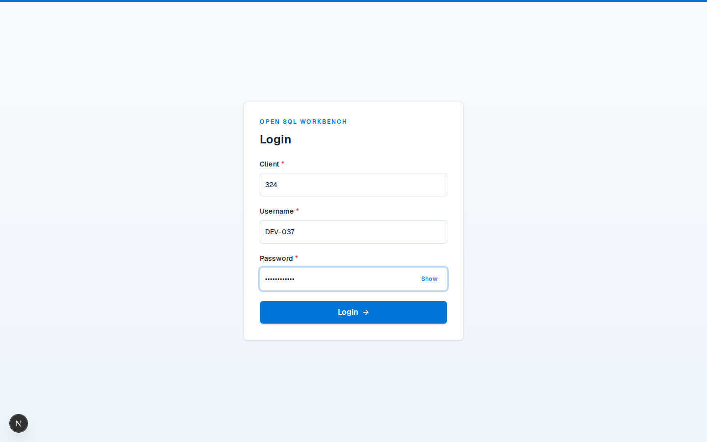
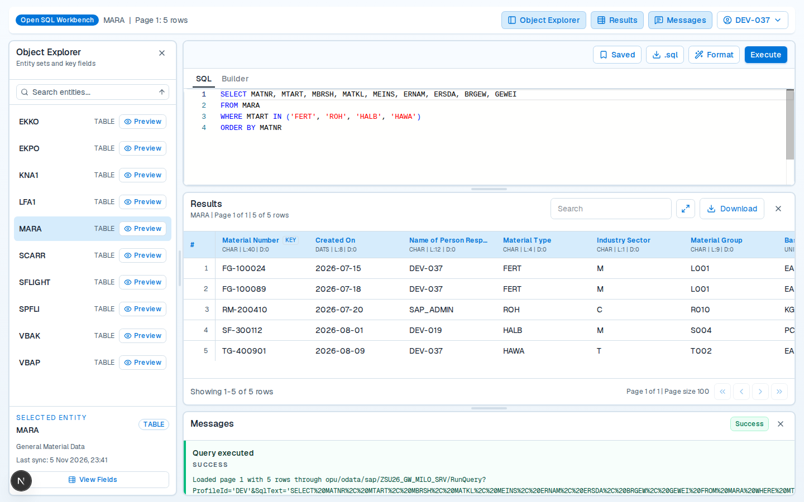
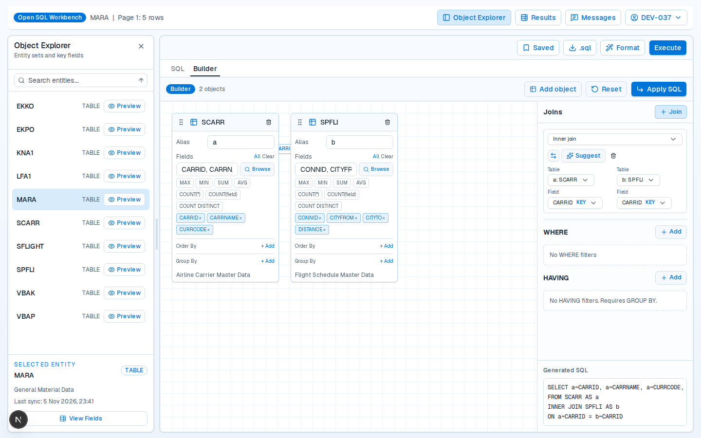
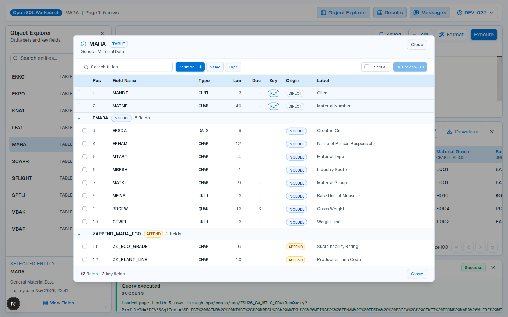
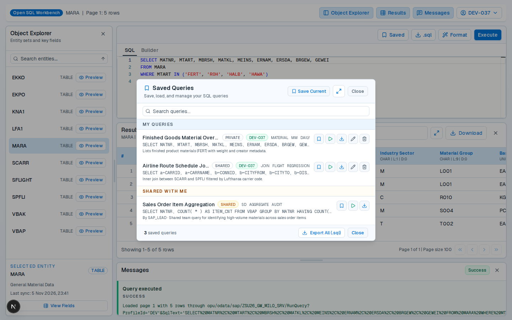
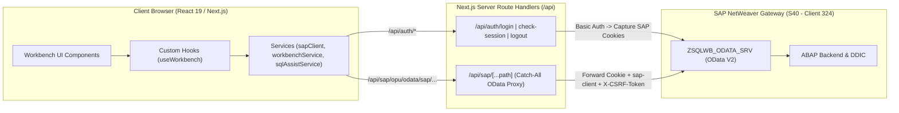

# Open SQL Workbench — Interactive ABAP SQL Workbench for SAP NetWeaver

**Open SQL Workbench** là ứng dụng web hiện đại được xây dựng trên nền tảng **Next.js App Router**, cung cấp môi trường truy vấn dữ liệu **ABAP Open SQL** trực quan, tốc độ cao kết nối trực tiếp với hệ thống **SAP NetWeaver (S40, Client 324)** thông qua dịch vụ **SAP Gateway OData V2 (`ZSQLWB_ODATA_SRV`)**.

Dự án được thiết kế nhằm thay thế quy trình tra cứu dữ liệu rời rạc trên các công cụ SAP GUI truyền thống như `SE16N` hay `SQVI`, mang lại trải nghiệm **"viết lệnh SQL — nhận kết quả tức thì"** giống như các trình quản trị cơ sở dữ liệu chuyên nghiệp.

---

## 📸 Hình Ảnh Giao Diện Dự Án (Project Screenshots)

### 1. Màn Hình Đăng Nhập SAP (SAP Session Sign-In)
Xác thực trực tiếp với SAP Gateway theo `Client`, `Username` và `Password` thông qua cơ chế **Stateless Session Cookie** bảo mật, giao diện lấy cảm hứng từ chuẩn thiết kế **SAP Fiori**.



---

### 2. Giao Diện Làm Việc Chính (SQL Editor, Results Grid & Action Output)
 Bố cục đa khung (Resizable Panels) gồm **Object Explorer** bên trái, **Monaco Open SQL Editor** ở trung tâm, bảng kết quả **Paginated Results Grid** và nhật ký thực thi **Messages / Action Output** ở phía dưới.



---

### 3. Trình Dựng Truy Vấn Trực Quan (Visual Query Builder)
Hỗ trợ kéo-thả hoặc thêm nhiều bảng, tự động gợi ý khóa nối (`INNER JOIN`, `LEFT OUTER JOIN`, `RIGHT OUTER JOIN`) hiển thị bằng đường nối SVG trực quan, chọn cột hiển thị (Projection), thiết lập điều kiện lọc `WHERE` / `GROUP BY` / `HAVING` và sinh mã Open SQL tự động.



---

### 4. Trình Khám Phá Cấu Trúc Bảng DDIC & Nguồn Gốc Trường (`DIRECT` / `INCLUDE` / `APPEND`)
Kiểm tra chi tiết metadata của từng bảng/view từ SAP Data Dictionary (`GetFields`), hiển thị khóa chính (`Key`), kiểu dữ liệu ABAP, độ dài, nhãn mô tả và gom nhóm theo cấu trúc nguồn (`DIRECT`, `INCLUDE`, `APPEND`, `CALCULATED`).



---

### 5. Quản Lý & Chia Sẻ Truy Vấn Đã Lưu (Saved Queries Manager)
Lưu trữ, phân loại theo thẻ (`Tags`), chỉnh sửa, xóa và chia sẻ các câu truy vấn thường dùng ở chế độ cá nhân (`PRIVATE`) hoặc toàn nhóm (`SHARED`), kèm tính năng xuất nhanh toàn bộ thư viện ra file `.sql`.



---

## ✨ Tính Năng Nổi Bật (Key Features)

### 🔐 1. Xác Thực SAP Stateless & Phân Quyền Theo Profile (PFCG Role)
- **Stateless Cookie Authentication:** Không lưu trữ mật khẩu hay bảng session phía client/database trung gian. Sau khi xác thực Basic Auth qua `$metadata`, hệ thống thu nhận các cookie phiên của SAP (`SAP_SESSIONID_*`, `MYSAPSSO2`, `SAPSSO2`) và đóng gói an toàn vào cookie `httpOnly` (`OSWB_SAP_COOKIE`).
- **Tự Động Quản Lý CSRF Token:** Mọi yêu cầu thay đổi trạng thái hoặc gọi Function Import (`POST`, `PUT`, `DELETE`) qua Proxy đều tự động lấy `X-CSRF-Token: Fetch` cùng phiên SAP trước khi thực thi.
- **Multi-Profile Selection (`SqlwbUserProfileSet`):** Tự động nhận diện danh sách `ProfileId` tương ứng với các PFCG Role (`ZSQLWB_ADMIN`, `ZSQLWB_DEV`, ...) được gán cho tài khoản SAP hiện tại và cho phép chuyển đổi linh hoạt ngay trên thanh công cụ.

### 💻 2. Trình Soạn Thảo ABAP Open SQL Thông Minh (Monaco Editor)
- **Tô Sáng Cú Pháp & Gợi Ý Tự Động (IntelliSense):** Gợi ý từ khóa Open SQL, tên bảng/view và tên trường dựa trên metadata thực tế của SAP DDIC.
- **Kiểm Tra Lỗi Thời Gian Thực (`openSqlValidation.ts`):** Phát hiện sớm các lỗi cú pháp Open SQL, các mệnh đề không được phép hoặc lỗi bí danh (alias) trong câu lệnh `JOIN` ngay khi đang gõ.
- **Định Dạng & Thực Thi Linh Hoạt:** Làm đẹp câu lệnh chỉ với 1 cú nhấp chuột (`Format`), hỗ trợ chạy toàn bộ câu lệnh hoặc chỉ chạy phần văn bản SQL đang bôi đen, và tải xuống câu lệnh dưới dạng file `.sql`.

### 🗂️ 3. Object Explorer & DDIC Metadata Inspector
- **Tra Cứu Nhanh (`SearchTables`):** Tìm kiếm theo tên kỹ thuật hoặc mô tả, sắp xếp `A → Z` / `Z → A` danh sách các bảng/view nằm trong danh sách cho phép (whitelist) của Profile.
- **Xem Nhanh Dữ Liệu (`PreviewTable`):** Xem ngay 100 bản ghi đầu tiên của bất kỳ bảng nào chỉ với một nút bấm `Preview`.
- **Phân Tích Nguồn Gốc Trường (`OriginType` / `OriginStructure`):** Hiển thị rõ trường được khai báo trực tiếp (`DIRECT`), nhúng qua `.INCLUDE` (`INCLUDE`) hay mở rộng qua `.INCLU--AP` (`APPEND`), đồng thời cho phép tích chọn trường để tạo nhanh câu lệnh `SELECT`.

### 🧩 4. Visual Query Builder (Kéo-Thả & Sinh Mã SQL)
- **Canvas Trực Quan:** Kéo-thả đối tượng từ Object Explorer hoặc chọn tối đa 5 bảng cùng lúc vào vùng thiết kế có lưới tọa độ mượt mà (tối ưu hóa GPU với `requestAnimationFrame` và `translate3d`).
- **Smart Join Suggestions:** Tự động chấm điểm và gợi ý cặp trường nối dựa trên khóa chính và tên trường tương đồng (tự động chặn trường `MANDT` theo quy chuẩn Open SQL).
- **Bộ Lọc Đầy Đủ:** Hỗ trợ xây dựng điều kiện `WHERE`, gom nhóm `GROUP BY` và lọc tổng hợp `HAVING` (`COUNT`, `SUM`, `AVG`, `MIN`, `MAX`).

### 📊 5. Bảng Kết Quả Động & Xuất Dữ Liệu (Dynamic Results Grid)
- **Đọc Dữ Liệu Phân Trang Theo Chunk (`SqlwbColumnSet` & `SqlwbPageChunkSet`):** Ghép nối các mảnh payload JSON lớn an toàn, tích hợp `jsonrepair` để phục hồi dữ liệu khi phản hồi bị cắt ngắn.
- **Tối Ưu Hóa Tốc Độ (Cache & Prefetch):** Lưu đệm các trang đã tải và tự động tải trước (prefetch) trang kế tiếp trong nền.
- **Tìm Kiếm, Toàn Màn Hình & Xuất File:** Lọc nhanh dữ liệu trong trang hiện tại, mở rộng bảng toàn màn hình (Fullscreen) và xuất kết quả ra **Excel (`.xlsx`)** hoặc **CSV (`.csv`)** chỉ với một cú nhấp chuột.

---

## 🏗️ Kiến Trúc Hệ Thống (System Architecture)

Dự án tuân thủ chặt chẽ kiến trúc phân lớp (**Layered Clean Architecture**) trên Next.js App Router (không dùng thư mục `src`). Trình duyệt **tuyệt đối không gọi trực tiếp** tới máy chủ SAP để tránh lỗi CORS và lộ thông tin xác thực; toàn bộ lưu lượng đều đi qua tầng **Catch-All Proxy** `/api/sap/[...path]`.



---

## 🛠️ Công Nghệ Sử Dụng (Technology Stack)

| Thành phần | Công nghệ / Thư viện | Phiên bản | Vai trò |
| :--- | :--- | :--- | :--- |
| **Framework** | Next.js (App Router) | `16.2.6` | Routing, Server API Proxy & SSR/CSR rendering |
| **UI Library** | React / React DOM | `19.2.4` | Xây dựng giao diện người dùng hướng thành phần |
| **Ngôn ngữ** | TypeScript | `^5` | Kiểm tra kiểu tĩnh nghiêm ngặt (Strict Typing) |
| **Styling & Design** | Tailwind CSS v4 + Radix UI / shadcn | `^4` | Hệ thống giao diện chuẩn SAP Fiori |
| **State & Fetching** | TanStack React Query | `^5.101.2` | Quản lý bất đồng bộ, caching và đồng bộ dữ liệu |
| **Code Editor** | Monaco Editor + `sql-formatter` | `^0.55.1` | Trình soạn thảo Open SQL, gợi ý lệnh và định dạng SQL |
| **Data Processing** | SheetJS (`xlsx`) + `jsonrepair` | `^0.18.5` | Xuất dữ liệu Excel/CSV và phục hồi chuỗi JSON |
| **HTTP Client** | Axios + Fetch API | `^1.16.1` | Giao tiếp HTTP từ phía Next.js Server sang SAP Gateway |
| **E2E Testing** | Playwright | `^1.61.0` | Kiểm thử tự động End-to-End (Mocked UI & Live SAP) |

---

## 📂 Cấu Trúc Thư Mục (Repository Structure)

```text
open_sql_workbench/
├── app/                                      # Layer 1: Routing & API Controllers (Next.js App Router)
│   ├── api/
│   │   ├── auth/
│   │   │   ├── login/route.ts                # Xác thực Basic Auth với SAP & thiết lập Session Cookie
│   │   │   ├── check-session/route.ts        # Kiểm tra hiệu lực phiên SAP qua $metadata
│   │   │   └── logout/route.ts               # Đăng xuất khỏi SAP Gateway & xóa cookie cục bộ
│   │   └── sap/[...path]/route.ts            # Catch-all Proxy chuyển tiếp OData V2 kèm CSRF Token
│   ├── login/page.tsx                        # Trang đăng nhập SAP
│   ├── workbench/page.tsx                    # Trang giao diện làm việc chính
│   ├── globals.css                           # Hệ thống token màu sắc & các lớp tiện ích .fiori-*
│   └── layout.tsx                            # Root Layout & QueryClient Provider
├── components/                               # Layer 2: Presentation (UI Components)
│   ├── ui/                                   # Các thành phần cơ sở (Button, Dialog, Table, Tabs, Toast...)
│   └── workbench/                            # Các phân hệ đặc thù của Open SQL Workbench
│       ├── workbench-dashboard.tsx           # Điều phối bố cục tổng thể, thanh chia khung (Resizable) & Profile
│       ├── query-workbench.tsx               # Thanh công cụ thực thi & chuyển đổi tab SQL / Builder
│       ├── sql-editor.tsx                    # Monaco Editor, autocomplete & chẩn đoán lỗi Open SQL
│       ├── visual-query-builder.tsx          # Canvas kéo-thả bảng, nối JOIN, lọc WHERE/HAVING & sinh SQL
│       ├── builder-node-card.tsx             # Thẻ hiển thị bảng trên Visual Query Builder
│       ├── builder-join-editor.tsx           # Bộ chỉnh sửa điều kiện nối bảng (JOIN)
│       ├── builder-filter-editor.tsx         # Bộ chỉnh sửa điều kiện lọc (WHERE / HAVING)
│       ├── entity-browser.tsx                # Object Explorer: tìm kiếm, sắp xếp & xem nhanh bảng
│       ├── table-properties-dialog.tsx       # Hộp thoại chi tiết trường DDIC & nguồn gốc DIRECT/INCLUDE/APPEND
│       ├── saved-queries-dialog.tsx          # Hộp thoại quản lý, chia sẻ và xuất các truy vấn đã lưu
│       ├── profile-selection-dialog.tsx      # Hộp thoại chọn Profile làm việc khi user có nhiều PFCG Role
│       ├── results-table.tsx                 # Bảng kết quả phân trang, tìm kiếm, Fullscreen & xuất Excel/CSV
│       └── action-output.tsx                 # Bảng nhật ký kết quả thực thi & thông báo lỗi (Messages)
├── hooks/                                    # Layer 3: Client Business Logic
│   └── use-workbench.ts                      # Quản lý trạng thái truy vấn, phân trang, cache và prefetch
├── services/                                 # Layer 4: Data Access Layer
│   ├── authService.ts                        # Gọi API đăng nhập, kiểm tra phiên và đăng xuất
│   ├── sapClient.ts                          # HTTP Client chuẩn hóa kết nối tới /api/sap/*
│   ├── sqlAssistService.ts                   # Gọi SearchTables, GetFields, UserProfiles & SavedQueries
│   └── workbenchService.ts                   # Gọi RunQuery, PreviewTable, SqlwbColumnSet & SqlwbPageChunkSet
├── lib/                                      # Layer 5: Utilities, Validators & Parsers
│   ├── sapParser.ts                          # Bóc tách dữ liệu OData V2 (formatODataResults) & ngày giờ SAP
│   ├── openSqlValidation.ts                  # Bộ phân tích và kiểm tra cú pháp ABAP Open SQL phía client
│   ├── openSqlFormatter.ts                   # Bộ định dạng câu lệnh Open SQL
│   ├── builderFilterUtils.ts                 # Chuẩn hóa giá trị lọc trong Visual Query Builder
│   └── sapSessionUtils.ts                    # Xử lý mã hóa/giải mã và làm sạch SAP Session Cookie
├── types/                                    # Layer 6: Strict TypeScript Definitions
│   ├── sap.ts                                # Kiểu dữ liệu DTO trả về từ SAP OData V2
│   ├── workbench.ts                          # Kiểu dữ liệu miền ứng dụng Workbench
│   └── builder.ts                            # Kiểu dữ liệu cho Visual Query Builder
├── tests/                                    # Kiểm thử tự động với Playwright
│   ├── e2e/workbench.spec.ts                 # Kiểm thử luồng giao diện với dữ liệu OData giả lập
│   ├── error-handling.spec.ts                # Kiểm thử xử lý lỗi cú pháp và phản hồi lỗi từ SAP
│   ├── filter-value-formatting.spec.ts       # Kiểm thử định dạng điều kiện lọc trong Builder
│   └── sql-workbench-all.spec.ts             # Bộ kiểm thử tích hợp trực tiếp với máy chủ SAP thật
└── docs/screenshots/                         # Hình ảnh chụp giao diện thực tế của dự án
```

---

## 🚀 Hướng Dẫn Cài Đặt & Khởi Chạy (Getting Started)

### 1. Yêu Cầu Hệ Thống (Prerequisites)
- **Node.js:** `>= 20.x`
- **Trình quản lý gói:** `npm` (đi kèm Node.js)
- Kết nối mạng (hoặc VPN) tới hệ thống **SAP NetWeaver Gateway** nếu chạy với dữ liệu SAP thực tế.

### 2. Cài Đặt Thư Viện (Installation)

```bash
git clone <repository-url>
cd open_sql_workbench
npm install
```

### 3. Cấu Hình Biến Môi Trường (`.env.local`)

Tạo file `.env.local` tại thư mục gốc của dự án với nội dung sau:

```env
# URL gốc của hệ thống SAP NetWeaver (chỉ đọc ở phía Server Route Handlers)
SAP_BASE_URL=https://<sap-host>:<port>/sap

# SAP Client mặc định (ví dụ: 324)
SAP_CLIENT=324

# Tên gói dịch vụ OData V2 trên SAP Gateway
NEXT_PUBLIC_SAP_PACKAGE=ZSQLWB_ODATA_SRV

# Profile mặc định khi khởi tạo (ví dụ: DEV)
NEXT_PUBLIC_SQLWB_PROFILE_ID=DEV
```

> **⚠️ Lưu ý bảo mật quan trọng:** Tuyệt đối **KHÔNG** lưu cứng tài khoản hoặc mật khẩu SAP (`SAP_USERNAME`, `SAP_PASSWORD`) vào trong mã nguồn hoặc commit lên Git. Người dùng sẽ đăng nhập trực tiếp qua giao diện `/login`.

### 4. Chạy Ứng Dụng Ở Chế Độ Phát Triển (Development)

```bash
npm run dev
```

Mở trình duyệt và truy cập:
- Trang đăng nhập: `http://localhost:3000/login`
- Trang làm việc chính: `http://localhost:3000/workbench`

### 5. Các Lệnh Kiểm Tra & Đóng Gói (Scripts)

```bash
# Kiểm tra lỗi cú pháp và quy chuẩn code với ESLint
npm run lint

# Kiểm tra kiểu dữ liệu TypeScript
./node_modules/.bin/tsc --noEmit

# Build ứng dụng cho môi trường Production
npm run build

# Khởi chạy máy chủ Production sau khi build
npm run start

# Chạy bộ kiểm thử tự động E2E với Playwright
npm run test:e2e
```

---

## 🔌 Tóm Tắt Các Endpoint OData V2 (`ZSQLWB_ODATA_SRV`)

| Chức năng | Phương thức & Endpoint | Mô tả |
| :--- | :--- | :--- |
| **Xác thực & Kiểm tra phiên** | `GET $metadata` | Xác thực Basic Auth khi đăng nhập và kiểm tra phiên hợp lệ |
| **Danh sách Profile của User** | `GET SqlwbUserProfileSet` | Trả về các `ProfileId` được phép dựa trên `sy-uname` và PFCG Role |
| **Tìm kiếm Bảng / View** | `GET SearchTables?ProfileId='...'&SearchText='...'&MaxRows=...` | Lấy danh sách các đối tượng dữ liệu nằm trong whitelist |
| **Lấy Cấu Trúc Trường DDIC** | `GET GetFields?ProfileId='...'&ObjectName='...'` | Lấy danh sách trường, kiểu dữ liệu, khóa và nguồn gốc `DIRECT`/`INCLUDE`/`APPEND` |
| **Thực thi câu lệnh Open SQL** | `POST RunQuery?ProfileId='...'&SqlText='...'&Page=1` | Thực thi truy vấn `SELECT`, trả về `ResultId` và thông tin phân trang |
| **Xem nhanh bảng (Preview)** | `POST PreviewTable?ProfileId='...'&ObjectName='...'&MaxRows=100&Page=1` | Trích xuất nhanh dữ liệu mẫu của bảng được chọn |
| **Đọc Cột & Dữ liệu Phân trang** | `GET SqlwbColumnSet` & `GET SqlwbPageChunkSet` | Tải cấu trúc cột và từng mảnh JSON dữ liệu theo `ResultId` và `PageNo` |
| **Quản lý Saved Queries** | `GET SqlwbSavedQuerySet`, `POST SaveQuery`, `POST UpdateSavedQuery`, `POST DeleteSavedQuery` | Xem danh sách, tạo mới, cập nhật và xóa các truy vấn đã lưu |

---

## 📌 Quy Tắc Truy Vấn ABAP Open SQL Cần Lưu Ý

1. **Chỉ hỗ trợ truy vấn đọc (`SELECT`):** Mọi câu lệnh thay đổi dữ liệu (`INSERT`, `UPDATE`, `DELETE`, `MODIFY`, `DROP`...) đều bị chặn ở cả tầng kiểm tra cú pháp Client và tầng bảo mật Backend ABAP.
2. **Quy tắc khi sử dụng `JOIN`:**
   - Bắt buộc liệt kê rõ danh sách các trường cần lấy kèm bí danh bảng (ví dụ: `SELECT a~CARRID, a~CARRNAME, b~CONNID`), **không** sử dụng `SELECT *` trong truy vấn có `JOIN`.
   - **Không** đưa trường `MANDT` vào điều kiện nối `ON` (ví dụ: `ON a~MANDT = b~MANDT` không hợp lệ vì SAP tự động xử lý Client).
3. **Giới hạn dòng dữ liệu:** Không sử dụng `SELECT TOP n` hay `UP TO n ROWS` trong câu lệnh SQL; việc giới hạn số dòng và phân trang được điều khiển tự động bởi tham số `Page` và `MaxRows` của Profile trên SAP Backend.
